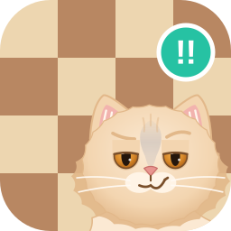
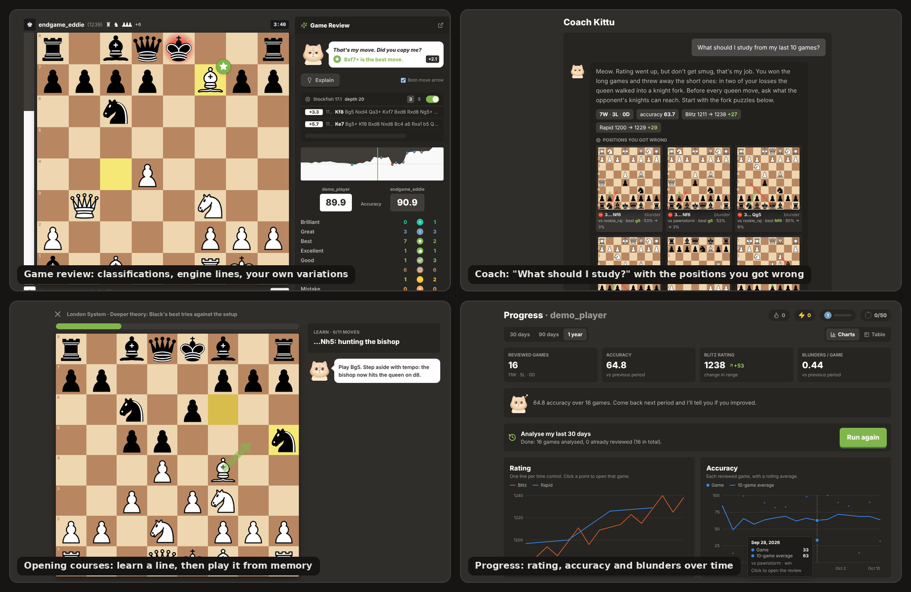
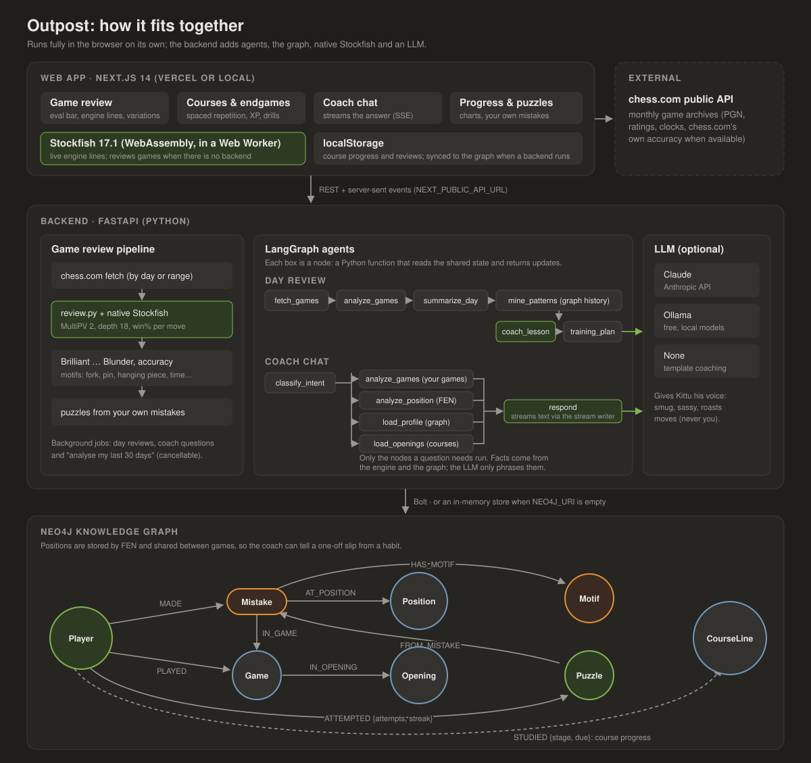

# Outpost

Chess training with **Kittu**, a smug cat coach who roasts your moves (never you) and still teaches.



## Getting started

**Option A, Docker (everything: Neo4j, API, web):**

```bash
git clone git@github.com:MubashirTanwar/outpost.git && cd outpost
docker compose up --build                         # http://localhost:3000
# free local AI coach:  docker compose --profile ollama up --build && docker compose exec ollama ollama pull llama3.1
# Claude as the coach:  LLM_PROVIDER=anthropic ANTHROPIC_API_KEY=sk-ant-... docker compose up --build
```

**Option B, no Docker:**

```bash
./scripts/setup.sh        # Python venv + deps, npm deps, .env files; checks for Stockfish
cd backend && .venv/bin/uvicorn app.main:app --reload     # API on :8000
cd web && npm run dev                                      # web on :3000
```

Requirements: Python 3.11+, Node.js 24, Stockfish (`brew install stockfish` / `apt install stockfish`), and optionally Neo4j 5 (leave `NEO4J_URI` empty to use the in-memory graph).

**Option C, Vercel (web only):** import this repo in Vercel and set **Root Directory** to `web`. With no `NEXT_PUBLIC_API_URL`, it runs in browser-only mode (see below).

## What's inside

A free, self-hosted alternative to chess.com's premium features. Enter your chess.com username and get:

- **Day Review**: every game you played on a given day, analysed by Stockfish and reviewed move by move with chess.com-style classifications (Brilliant `!!`, Great `!`, Best, Excellent, Good, Book, Inaccuracy `?!`, Mistake `?`, Miss, Blunder `??`), accuracy scores, key moments, and a written lesson from an AI coach.
- **Game Review**: a chess.com-style review screen with eval bar, advantage graph, move list with classification icons, best-move arrows, a "Retry" mode for your mistakes, and an AI "Explain" button. It also has live engine lines (top 3 or 5, with depth), and you can play your own moves on the board to explore variations.
- **Linked lessons**: every game and move mentioned in the day's lesson is a link with a hover preview of the position (your move vs the best one).
- **Your Puzzles**: every mistake you make becomes a puzzle, served with spaced repetition and filterable by theme (forks, hanging pieces, back-rank, missed mates…). Mates and tactics run several moves, your opponent always replies, and any move as good as the engine's counts.
- **Progress**: an "Analyse my last 30 days" button reviews every recent game in the background (it keeps going if you leave the page; without a backend it runs in the open tab), then charts rating per time control, accuracy per game with a rolling average, and blunders per game over 30 days, 90 days or a year, with hover tooltips and a table view. It also shows your course and endgame progress. Click a point to open that game.
- **AI Coach chat**: ask things like "What went wrong in my latest game?", "Why did I lose rating yesterday?" or "What should I study from my last 10 games?". The coach reviews any games it hasn't seen yet, then answers with the exact numbers (record, rating change per time control), the turning point of each game, your recurring patterns, and a study plan linked to your puzzles, course lines and endgame lessons. Every game and move it mentions is a link with a hover preview, and the positions you got wrong are shown as boards under the answer. Answers stream in as the model writes them (server-sent events from a LangGraph custom stream). It also answers questions about your weaknesses, openings, or a specific position.
- **Opening courses (Chessly/Duolingo-style)**: six full repertoires (Italian, London and Queen's Gambit for White; Caro-Kann, French and Scandinavian for Black) with 133 lines and 25 hand-written quizzes. Each lesson is learned with hints, then played from memory. After that, spaced-repetition reviews, a drill shuffle and quizzes keep it fresh. Progress shows as XP, levels, a streak, a daily goal and achievements.
- **Endgame Academy**: 4 stages (basic mates, king and pawn, rook endings, advanced), 13 lessons and 27 drills. Each lesson has theory cards with step-through demos, then several variations to play out against Stockfish for up to 3 stars.
- **Analysis board**: Stockfish 17.1 running in your browser, with three lines.

The UI copies the look of chess.com: dark theme, cream-and-brown board, animated pieces, and move/capture/check sounds. The sounds are synthesised in the browser and the piece set is the open-licensed one bundled with react-chessboard; chess.com's own artwork and audio are not included.

## Architecture



- **Web app** (Next.js): everything you see. It runs Stockfish 17.1 in the browser, so with no backend it still reviews games and keeps your progress in localStorage.
- **Backend** (FastAPI): fetches games from chess.com, reviews them with native Stockfish, and runs two LangGraph agents. The **day review** walks a fixed pipeline; the **coach** routes each question to only the steps it needs (your games, a position, your profile, your openings), then streams the answer.
- **Neo4j**: every reviewed game, mistake, position, motif, puzzle and course line, linked together. Positions are keyed by FEN, so the coach can see that you went wrong in the *same position* in different games, or keep making the same kind of mistake. With `NEO4J_URI` empty an in-memory store stands in.
- **LLM** (optional): Claude or a local Ollama model gives Kittu his voice. The facts (evals, best moves, counts, rating changes) always come from the engine and the graph; with no LLM the coach uses templates.

### How moves are classified

Each position is analysed with MultiPV 2. Evaluations are converted to winning chances with Lichess' curve (`50 + 50·(2/(1+e^(−0.00368·cp)) − 1)`). The drop in winning chances decides the class: <2 excellent, <5 good, <10 inaccuracy, <20 mistake, otherwise blunder. On top of that:

- **Best**: you played the engine's top move.
- **Great**: the top move, where the second-best move was at least 15% worse (the only good move).
- **Brilliant**: a near-best move that sacrifices material (checked along the engine line, or by leaving a piece en prise), leaves you at least equal, and isn't played from an already completely winning position (above 90% winning chances).
- **Miss**: a mistake or blunder that failed to punish your opponent's own mistake.
- **Book / Forced**: opening theory, or the only legal move.

Accuracy uses Lichess' per-move formula, blended from the arithmetic and harmonic means. Reviews run at depth 18 by default, about what chess.com uses.

#### Comparing with chess.com

chess.com's review algorithm isn't public, so the numbers won't match exactly. When a game has also been reviewed on chess.com, its API reports chess.com's accuracy, and the review screen shows it under ours. To measure the gap on your own games:

```bash
cd backend && python scripts/compare_chesscom.py YOUR_USERNAME --games 30
```

It reviews your recent games that chess.com has reviewed, prints both accuracies side by side with the average error, and reports the win% curve steepness that would have matched chess.com best. The details are saved to `compare-<username>.json`. Mistakes are tagged with motifs: `hanging_piece`, `fork`, `pin`, `allowed_mate`, `back_rank`, `missed_mate`, `missed_tactic`, `weakened_king`, `time_pressure`, plus the game phase. The same logic runs in Python (`backend/app/review.py`) and TypeScript (`web/src/lib/classify.ts`), and both have the same tests.

## Opening courses

Course content lives in `courses/*.course`, a plain-text format with PGN move text and `{comments}` that become the explanations shown during lessons:

```
chapter: advance
title: Advance Variation: 3.e5
intro: ...
line: adv-short
name: Short System: Nf3 and Be2
moves: 1.e4 c6 {Prepare ...d5 ...} 2.d4 d5 3.e5 Bf5 {The key Caro-Kann move ...} ...
quiz: adv-short 6
q: White played 3.e5. What's the key idea now?
a: 3...Bf5: develop the bishop before ...e6
w: 3...e6 straight away
why: ...
```

`python courses/build.py` validates every course and writes `courses.json` for the backend and the web app. It checks that every move is legal, that every line ends on your move, that quiz positions exist, and that **every position where it's your turn has exactly one repertoire move across the whole course, including transpositions**, so drills are never ambiguous. Two more checks:

- `python courses/build.py --engine stockfish --depth 18` flags any repertoire move that loses more than 0.7 pawns compared with Stockfish's choice.
- `python courses/coverage.py` asks the Lichess opening explorer which opponent moves real club players make in each course position, and lists popular ones no line covers yet. The explorer may need a free `LICHESS_TOKEN`.

**How learning works**

| | |
|---|---|
| Learn | The board shows each move with an arrow and an explanation, and you play it. Moves you already know from other lines are played for you. Then you replay the whole line from memory. |
| Review | No hints. A wrong move counts as a mistake and shows the right one. A perfect review moves the line up the ladder (4h, 1d, 3d, 1w, 2w, 1mo, 3mo, 6mo); a mistake drops it two steps. A line counts as *mastered* once it survives the one-week review. |
| Drill shuffle / Quiz | Random learned lines, and multiple-choice questions: hand-written idea questions plus "find the repertoire move" positions from lines you've learned. |
| Path | Each chapter is a Duolingo-style path. The next line unlocks when you finish the previous one, and each node shows new, learning (with a progress ring), mastered (crown) or due (clock). |

Progress is kept in your browser and, when the backend is running, synced to Neo4j as `(:Player)-[:STUDIED {stage, due}]->(:CourseLine)`, so it follows you across devices. The day review then checks your real games against the courses you study. It tells you where *you* left the course ("you played 5.d4, the course plays 5.d3: review this line"), or where your *opponent* played a move the course doesn't cover yet.

### Growing the courses with real-game data

`courses/expand.py` drafts new lines from the Lichess opening explorer. For every opponent move in a course it finds the popular replies (default ≥5% of club games) that no line answers. It then extends each one with your most popular move that Stockfish rates within 0.4 pawns of its own choice. Drafts land in `courses/drafts/` for you to review, comment and paste in:

```bash
python courses/expand.py --course caro-kann        # or --all; add LICHESS_TOKEN=... if the explorer asks
python courses/build.py --engine stockfish        # validate + engine-check after pasting lines in
```

The endgame course lives in `courses/endgames.endgame` and is built with `python courses/build_endgames.py` (add `--engine stockfish` to check every drill is really won or drawn).

## Run it locally (full stack)

```bash
docker compose up --build                    # Neo4j + API + web, template coaching
# or with a free local LLM:
docker compose --profile ollama up --build
docker compose exec ollama ollama pull llama3.1
# or with Claude:
LLM_PROVIDER=anthropic ANTHROPIC_API_KEY=sk-ant-... docker compose up --build
```

Open http://localhost:3000. Neo4j's browser is at http://localhost:7474 (user `neo4j`, password `chesscoach`). Try `MATCH (p:Player)-[:MADE]->(m)-[:HAS_MOTIF]->(mo) RETURN mo.name, count(*)`.

### Without Docker

```bash
# Backend
brew install stockfish          # or: apt install stockfish
cd backend
python -m venv .venv && . .venv/bin/activate
pip install -r requirements-dev.txt
cp .env.example .env            # set STOCKFISH_PATH, NEO4J_URI (blank = in-memory), LLM_PROVIDER
uvicorn app.main:app --reload

# Frontend
cd ../web
npm install                     # also copies the Stockfish WASM build into public/
NEXT_PUBLIC_API_URL=http://localhost:8000 npm run dev
```

## Deploy the frontend to Vercel

1. Import the repo in Vercel and set **Root Directory** to `web`.
2. Optionally set `NEXT_PUBLIC_API_URL` to a backend you host (any machine running the Docker image, or your own computer through a tunnel such as `cloudflared tunnel --url http://localhost:8000`). Set `CORS_ORIGINS` on the backend to your Vercel URL.

With no backend, the Vercel deploy runs in **browser-only mode**. Game and day reviews run with Stockfish WASM in your browser and are stored in `localStorage`, and puzzles from your mistakes, the opening and endgame trainers and the analysis board all work. The AI coach and the cross-game pattern graph need the backend.

## Configuration (backend)

| Variable | Default | |
|---|---|---|
| `STOCKFISH_PATH` | `stockfish` | Binary path, or a command such as `node /path/stockfish.js` |
| `ENGINE_DEPTH` | `18` | Depth per position (about what chess.com uses). Lower it (e.g. 14) on a slow machine |
| `BACKFILL_DEPTH` | `14` | Depth for the background "last 30 days" analysis, which only feeds the charts. About 5x faster than 18 |
| `NEO4J_URI` | *(empty)* | Empty = in-memory graph (lost on restart) |
| `LLM_PROVIDER` | `none` | `anthropic`, `ollama`, or `none` |
| `ANTHROPIC_MODEL` | `claude-opus-5-5` | Effort is set by `ANTHROPIC_EFFORT` (default `medium`) |
| `OLLAMA_MODEL` | `llama3.1` | Any model you have pulled |

With `LLM_PROVIDER=anthropic`, requests opt into server-side refusal fallbacks (`fallbacks: "default"`). Whatever the provider, if the LLM is unreachable the agents fall back to template coaching, so a review never fails because of the LLM.

## Tests

```bash
cd backend && pytest                       # classifier, agents (fake engine), API
STOCKFISH_PATH=/usr/games/stockfish pytest # + real-engine test
NEO4J_TEST_URI=bolt://localhost:7687 pytest tests/test_neo4j.py
cd ../web && npm test && npm run typecheck && npm run build
python ../courses/build.py --check       # course data valid and JSON up to date
```

CI (`.github/workflows/ci.yml`) runs all of these against real Stockfish and Neo4j.
